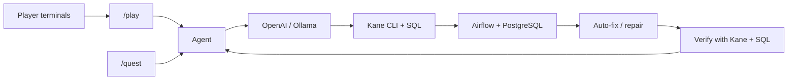

# Bug Quest

**Bug Quest: an AI agent and multiplayer game that catches silent data pipeline failures, auto-fixes them, and proves the fix.**

[Demo video](https://d3nl4wy7jovhq0.cloudfront.net/public/p66/6849dfc359e35065374c6f0dbf23fcbc6dbe3d382721743fd4be95119d896338.mp4)

## The problem

A DAG can report success while half its rows disappear. A basic Kane instruction—“Check the pipeline ran”—passed our broken pipeline because it checked completion, not data conservation. Green tasks need precise assertions about the data they produce.

## What it does

- Turns plain-English instructions into precise checks with expected values.
- Runs Kane CLI browser checks and SQL against a real Airflow pipeline and PostgreSQL warehouse.
- Auto-fixes the DAG in `/quest` using Git checkpoints, up to three attempts, rollback, and escalation when verification fails.
- Turns testing into a multiplayer game with animated animal characters created in the terminal: name, animal, traits, private character, and public bio.

## Screenshots

Real local captures; the game image shows two joined players before a round. [Latest theme, laptop layout, and Winter quest evidence](docs/images/theme/README.md).

**Shared game: animals and leaderboard**


**Quest results: replay of recorded Kane runs**


**Real Airflow DAG**


**Quest show screen:** open `/stage` in a second window from **Open stage** on `/quest`. Each agent gets a unique animal for the session, and returning agents keep their assignment. The quest scoreboard shows the same animal. Up to eight agents can join before a leaderboard reset. The shared session leaderboard accumulates confirmed catches (+20), verified fixes (+15), and explicit disproven bug claims (−5). Normal passes and infrastructure errors earn no penalty. Reset leaderboard clears the display; an active quest keeps running. The control screen holds the form, logs, reports, and the agent’s animal avatar.

Run the same quest from a terminal while the local server is running:

```sh
npm run quest
npm run quest -- --name Moss --instruction "Verify loaded rows equal extracted rows"
```

The CLI asks **Name your agent**, then **What should your agent check?**, then waits for **Enter** to start (or `cancel` to exit). Both answers are required. Flags only prefill answers; they never skip the prompts or final confirmation. Non-interactive invocations are rejected. It uses Real Airflow, streams logs and results, and registers the agent on `/stage` only after confirmation. Ctrl+C cancels. It never opens a browser window.

## Architecture



`/quest` uses OpenAI to edit only the target pipeline file and commits a fix after verification. `/play` supports OpenAI or Ollama; game repairs are isolated reruns with caught faults disabled, preserving identical starting faults for each player. They do not edit or commit source code.

## Verified results

**2,986 extracted vs 1,493 loaded → fixed → 2,986 extracted = 2,986 loaded**, with all six Airflow tasks successful and Kane + SQL verification passing. Winter’s real quest on 2026-11-06 caught the half-load bug and committed the verified repair (`e553308`). The standalone DAG now loads every row; `/play` still plants faults explicitly per round. See [the run evidence](docs/images/theme/validation-2026-11-06/winter.json).

- **90 tests pass**, plus TypeScript typecheck.
- Two terminal players verified: **+20** per bug caught, **+15** per verified repair, **−5** per false claim; the round reset to 2,986 extracted / loaded / wins.
- Evidence: [real auto-fix](real-pipeline/verification-2026-10-27.json) · [two-player game](real-pipeline/play-animal-verification-2026-11-01.json).

## Quick start

**Prerequisites:** Node.js 20.9+, npm, Git, Docker with Compose, PostgreSQL client (`psql`), Chrome, and an installed, authenticated Kane CLI. Game play also needs OpenAI API access or a running Ollama server with a downloaded model. `/quest` Live mode requires OpenAI.

```sh
git clone https://github.com/EstrellaAce29/bug-quest.git
cd bug-quest
npm ci
cp .env.example .env.local
kane-cli login --oauth
```

Fill `.env.local` locally. Key names only:

| Purpose | Keys |
|---|---|
| OpenAI | `OPENAI_API_KEY`, optional `OPENAI_MODEL` |
| Airflow | `AIRFLOW_URL`, `AIRFLOW_PORT`, `AIRFLOW_USERNAME`, `AIRFLOW_PASSWORD` |
| PostgreSQL | `PGHOST`, `PGPORT`, `PGUSER`, `PGPASSWORD`, `PGDATABASE` |
| Game model, optional | `PLAY_MODEL_PROVIDER`, `PLAY_MODEL` |
| Ollama, when selected | `OLLAMA_BASE_URL`, `OLLAMA_MODEL` |

Use the loopback addresses and ports in `.env.example`: Airflow UI **localhost:8081**, PostgreSQL **localhost:5433**. Credentials stay server-side; `.env.local`, raw CSVs, logs, and local character profiles are ignored.

Place the attributed ATP CSV at `data/raw/atp_matches_2023.csv`; see the [exact source and checksum](real-pipeline/DATA_SOURCE.md). Build and initialize Airflow once:

```sh
cd real-pipeline
cp .env.example .env
docker compose --env-file ../.env.local build
docker compose --env-file ../.env.local up airflow-init
cd ..
./start.sh
```

For subsequent runs, use `./start.sh` from the repository root. `npm run dev` uses Next’s Webpack mode to avoid the repeated page reloads observed with this installed Turbopack version. It checks Docker (and prompts you to open Docker Desktop if needed), runs `docker compose --env-file ../.env.local up -d` from `real-pipeline/`, waits up to five minutes for Airflow's database and scheduler health at localhost:8081, then runs `npm run dev` in the foreground. Requires `curl` in addition to Node.js and Docker.

Run `./stop.sh` in another terminal to stop the dev server started by the script and stop the Airflow stack, preserving its database volume. Ctrl+C in the start terminal stops the dev server; run `./stop.sh` to also stop Airflow. Servers started separately with `npm run dev` must be stopped in their own terminal.

Open [Airflow](http://localhost:8081), sign in with your local Airflow credentials, unpause `tennis_tournament_pipeline`, and trigger it once. Open [Bug Quest](http://127.0.0.1:3000/play), create a two-player lobby, and copy its join code.

In **two separate terminals**, replace `<CODE>` with that code:

```sh
npm run player -- --code <CODE>
```

Complete the character wizard, submit a strategy in each terminal, then start the round in the browser. Three rounds share the same planted faults per player and reset between rounds. Reuse a character with `--character NAME`.

Check the warehouse or run repository checks:

```sh
node scripts/check_real_pipeline.mjs
npm test
npm run typecheck
```

The warehouse checker intentionally fails while the half-load bug is active. See [pipeline setup and recovery details](real-pipeline/README.md).

## Modes

| Mode | Route | Use |
|---|---|---|
| Simulated monitor | `/pipelines` | JSON-backed enrollment pipeline with switchable faults. |
| Real Airflow | `/quest` | Enter an agent name, select Real Airflow, and click Run for the guarded DAG auto-fixer. Nothing starts on page load; recorded evidence is collapsed under Past runs. |
| Game | `/play` | Shared animal stage, terminal controllers, live checks, scoring, reveals, and resets. |

## Tech stack

Next.js · React · TypeScript · Node.js · OpenAI API / Ollama · Kane CLI · Apache Airflow · PostgreSQL · Docker

On `/quest`, enter **Name your agent** and click **Continue**. Then enter a required free-text answer to **What should your agent check?** and click **Run**. Pressing Enter in the name step only continues to the prompt; Enter in the prompt adds a newline. Nothing starts on page load, when `/stage` opens, or from `start.sh`. After explicit Run/CLI confirmation, the requested checks, repairs and verification proceed. Kane always runs headlessly, including repair verification and game rounds. The Watch Kane control is removed, and `KANE_HEADLESS=false` cannot enable windows.

Run immediately writes progress to the live log and shows the current phase beside the Run button. **Cancel** is available beside the form and in the live-log header. Limits: OpenAI planning 60s, fix proposal 90s, each Kane run (including evidence upload) 180s, Airflow parsing 120s, DAG completion 300s. A silent connection fails after 15s; a silent progress stream fails after 30s. Timeout errors name the failed step; timed-out repairs restore the checkpoint before reporting the error. [Spinner diagnosis and verification](docs/quest-spinner-2026-11-08/README.md).


## Limitations

- Local demo for one tennis DAG and a small set of supported invariants; it is not a general pipeline repair service.
- Game rooms live in memory and disappear on server restart. Saved characters remain local.
- Game repairs are runtime remediations; source-editing auto-fixes belong to `/quest`.
- Ollama has adapter-test coverage; the recorded end-to-end game used OpenAI.
- Live runs consume model usage and Kane credits. Browser automation can time out; failed cleanup blocks play until recovery succeeds.
- The warehouse holds the latest load. Avoid triggering unrelated tennis runs during a quest or game.

## Credits

Built at **Kane CLI Hack Day SF (Oct 2026)**. Browser testing and evidence by Kane CLI.

ATP 2023 tennis data compiled by [Jeff Sackmann](https://github.com/JeffSackmann/tennis_atp), licensed [CC BY-NC-SA 4.0](https://creativecommons.org/licenses/by-nc-sa/4.0/). The dataset is separate from this repository’s [MIT-licensed code](LICENSE).

## Author

**Prashansa Chaudhary** · GitHub [@EstrellaAce29](https://github.com/EstrellaAce29) · X [@EstrellaAcePC](https://x.com/EstrellaAcePC)
