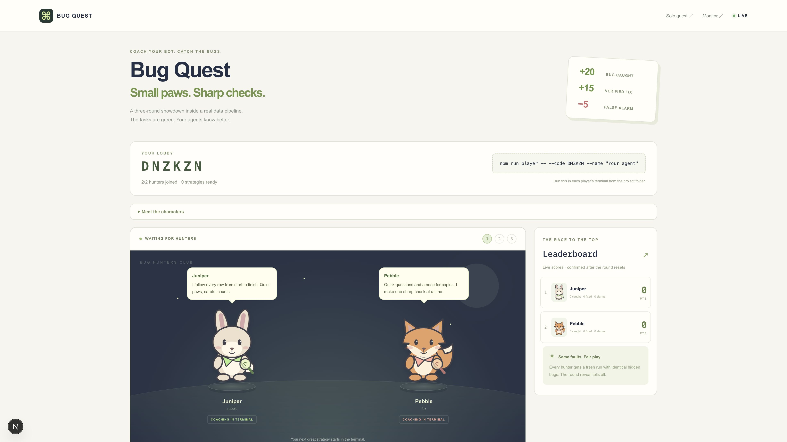
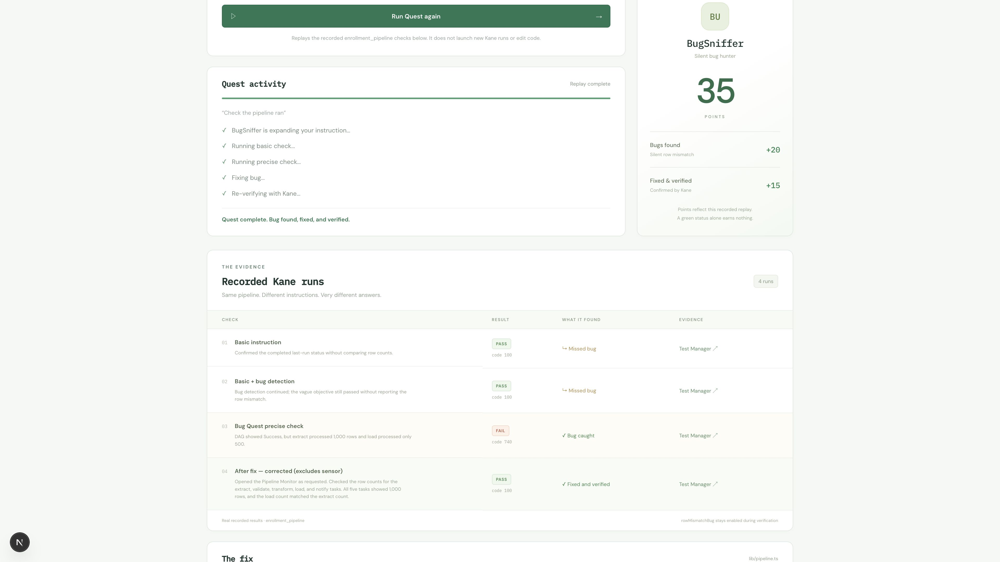
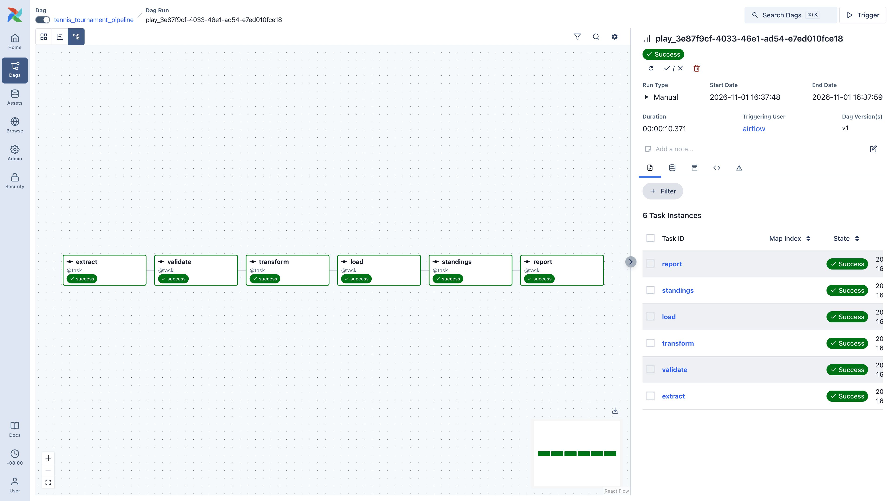
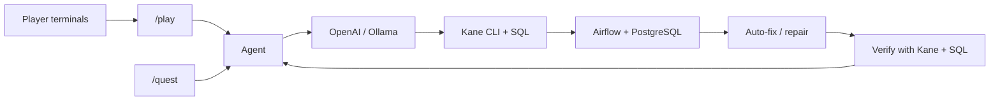

# Bug Quest

**Bug Quest: an AI agent and multiplayer game that catches silent data pipeline failures, auto-fixes them, and proves the fix.**

[Demo video](https://d3nl4wy7jovhq0.cloudfront.net/public/p66/6849dfc359e35065374c6f0dbf23fcbc6dbe3d382721743fd4be95119d896338.mp4)

## The problem

A DAG can report success while half its rows disappear. A basic Kane instruction—“Check the pipeline ran”—passed our broken pipeline because it checked completion, not data conservation. Green tasks need precise assertions about the data they produce.

## What it does

- Turns plain-English instructions into precise checks with expected values.
- Runs Kane CLI browser checks and SQL against a real Airflow pipeline and PostgreSQL warehouse.
- Auto-fixes the DAG in `/quest` using Git checkpoints, up to three attempts, rollback, and escalation when verification fails.
- Turns testing into a multiplayer game with animated animal characters created in the terminal: name, animal, traits, private character, and public bio.

## Screenshots

Real local captures; the game image shows two joined players before a round.

**Shared game: animals and leaderboard**



**Quest results: replay of recorded Kane runs**



**Real Airflow DAG**



**Quest show screen:** open `/stage` in a second window from **Open stage** on `/quest`. Animals are assigned consistently from agent names. The shared session leaderboard accumulates confirmed catches (+20), verified fixes (+15), and explicit disproven bug claims (−5). Normal passes and infrastructure errors earn no penalty. Reset leaderboard clears the display; an active quest keeps running. The control screen holds the form, logs, and reports; it has no animal characters.

Run the same quest from a terminal while the local server is running:

```sh
npm run quest -- --name Winter
npm run quest -- --name Moss --instruction "Verify loaded rows equal extracted rows"
```

The CLI uses Real Airflow, matching the control screen default, streams logs and results, and registers the agent on `/stage`. Ctrl+C cancels the quest.

## Architecture



`/quest` uses OpenAI to edit only the target pipeline file and commits a fix after verification. `/play` supports OpenAI or Ollama; game repairs are isolated reruns with caught faults disabled, preserving identical starting faults for each player. They do not edit or commit source code.

## Verified results

**2,986 extracted vs 1,493 loaded → fixed → 2,986 extracted = 2,986 loaded**, with all six Airflow tasks successful and Kane + SQL verification passing. Fresh clones intentionally retain the half-load bug for the next demo.

- **71 tests pass**, plus TypeScript typecheck.
- Two terminal players verified: **+20** per bug caught, **+15** per verified repair, **−5** per false claim; the round reset to 2,986 extracted / loaded / wins.
- Evidence: [real auto-fix](real-pipeline/verification-2026-10-27.json) · [two-player game](real-pipeline/play-animal-verification-2026-11-01.json).

## Quick start

**Prerequisites:** Node.js 20.9+, npm, Git, Docker with Compose, PostgreSQL client (`psql`), Chrome, and an installed, authenticated Kane CLI. Game play also needs OpenAI API access or a running Ollama server with a downloaded model. `/quest` Live mode requires OpenAI.

```sh
git clone https://github.com/EstrellaAce29/bug-quest.git
cd bug-quest
npm ci
cp .env.example .env.local
kane-cli login --oauth
```

Fill `.env.local` locally. Key names only:

| Purpose | Keys |
|---|---|
| OpenAI | `OPENAI_API_KEY`, optional `OPENAI_MODEL` |
| Airflow | `AIRFLOW_URL`, `AIRFLOW_PORT`, `AIRFLOW_USERNAME`, `AIRFLOW_PASSWORD` |
| PostgreSQL | `PGHOST`, `PGPORT`, `PGUSER`, `PGPASSWORD`, `PGDATABASE` |
| Kane browser | `KANE_HEADLESS` |
| Game model, optional | `PLAY_MODEL_PROVIDER`, `PLAY_MODEL` |
| Ollama, when selected | `OLLAMA_BASE_URL`, `OLLAMA_MODEL` |

Use the loopback addresses and ports in `.env.example`: Airflow UI **localhost:8081**, PostgreSQL **localhost:5433**. Credentials stay server-side; `.env.local`, raw CSVs, logs, and local character profiles are ignored.

Place the attributed ATP CSV at `data/raw/atp_matches_2023.csv`; see the [exact source and checksum](real-pipeline/DATA_SOURCE.md). Then start Airflow:

```sh
cd real-pipeline
cp .env.example .env
docker compose --env-file ../.env.local build
docker compose --env-file ../.env.local up airflow-init
docker compose --env-file ../.env.local up -d
cd ..
npm run dev
```

Open [Airflow](http://localhost:8081), sign in with your local Airflow credentials, unpause `tennis_tournament_pipeline`, and trigger it once. Open [Bug Quest](http://127.0.0.1:3000/play), create a two-player lobby, and copy its join code.

In **two separate terminals**, replace `<CODE>` with that code:

```sh
npm run player -- --code <CODE>
```

Complete the character wizard, submit a strategy in each terminal, then start the round in the browser. Three rounds share the same planted faults per player and reset between rounds. Reuse a character with `--character NAME`.

Check the warehouse or run repository checks:

```sh
node scripts/check_real_pipeline.mjs
npm test
npm run typecheck
```

The warehouse checker intentionally fails while the half-load bug is active. See [pipeline setup and recovery details](real-pipeline/README.md).

## Modes

| Mode | Route | Use |
|---|---|---|
| Simulated monitor | `/pipelines` | JSON-backed enrollment pipeline with switchable faults. |
| Real Airflow | `/quest` | Enter an agent name, select Real Airflow, and click Run for the guarded DAG auto-fixer. Nothing starts on page load; recorded evidence is collapsed under Past runs. |
| Game | `/play` | Shared animal stage, terminal controllers, live checks, scoring, reveals, and resets. |

## Tech stack

Next.js · React · TypeScript · Node.js · OpenAI API / Ollama · Kane CLI · Apache Airflow · PostgreSQL · Docker

Kane runs headlessly by default for quests, game rounds, terminal players, and repair verification. Progress streams into the live logs. An instruction is optional and defaults to “Check the pipeline ran.” Once you click Run, checks, repairs, reruns and verification proceed automatically. Enable **Watch Kane** on `/quest` only when you want a visible browser for a demo; it stays off by default. `KANE_HEADLESS` is read server-side from `.env.local`.

## Limitations

- Local demo for one tennis DAG and a small set of supported invariants; it is not a general pipeline repair service.
- Game rooms live in memory and disappear on server restart. Saved characters remain local.
- Game repairs are runtime remediations; source-editing auto-fixes belong to `/quest`.
- Ollama has adapter-test coverage; the recorded end-to-end game used OpenAI.
- Live runs consume model usage and Kane credits. Browser automation can time out; failed cleanup blocks play until recovery succeeds.
- The warehouse holds the latest load. Avoid triggering unrelated tennis runs during a quest or game.

## Credits

Built at **Kane CLI Hack Day SF (Oct 2026)**. Browser testing and evidence by Kane CLI.

ATP 2023 tennis data compiled by [Jeff Sackmann](https://github.com/JeffSackmann/tennis_atp), licensed [CC BY-NC-SA 4.0](https://creativecommons.org/licenses/by-nc-sa/4.0/). The dataset is separate from this repository’s [MIT-licensed code](LICENSE).

## Author

**Prashansa Chaudhary** · GitHub [@EstrellaAce29](https://github.com/EstrellaAce29) · X [@EstrellaAcePC](https://x.com/EstrellaAcePC)
