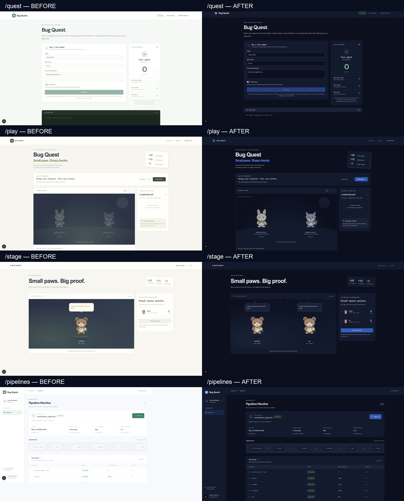

# Theme and laptop layout verification

Current verification: **2026-11-06**. All four routes use the shared blue-black theme, white/secondary text, blue accents, and green/red scores. Body text and headings use Arial; code uses the shared monospace stack. Side panels stack below 1100px. Animals stay unique within a session, and the quest avatar matches the assigned stage animal.

All **12 route/width combinations passed** DOM measurements and visual review: no document horizontal overflow, balanced main margins, visible headings and controls, and side panels beside the main panel at 1440/1280px and below it at 1024px. Both scoring legends have no rotation.

| Route | 1440px | 1280px | 1024px |
| --- | --- | --- | --- |
| `/quest` | [Screenshot](validation-2026-11-06/quest-1440.png) | [Screenshot](validation-2026-11-06/quest-1280.png) | [Screenshot](validation-2026-11-06/quest-1024.png) |
| `/stage` | [Screenshot](validation-2026-11-06/stage-1440.png) | [Screenshot](validation-2026-11-06/stage-1280.png) | [Screenshot](validation-2026-11-06/stage-1024.png) |
| `/play` | [Screenshot](validation-2026-11-06/play-1440.png) | [Screenshot](validation-2026-11-06/play-1280.png) | [Screenshot](validation-2026-11-06/play-1024.png) |
| `/pipelines` | [Screenshot](validation-2026-11-06/pipelines-1440.png) | [Screenshot](validation-2026-11-06/pipelines-1280.png) | [Screenshot](validation-2026-11-06/pipelines-1024.png) |

[Measured layout and computed fonts/colors](validation-2026-11-06/layout.json) · [Visual review](validation-2026-11-06/visual-audit.json).

## Winter’s real quest

With Docker and Airflow healthy, a fresh normal DAG run succeeded while loading only **1,493 of 2,986 rows**. `npm run quest -- --name Winter` passed the basic run check, caught the silent row loss through SQL, repaired it on attempt one, triggered a fresh run, and passed Kane + SQL and the unchanged basic check. Auto-fix commit: **e553308**. The repaired DAG remains in place; game fault flags still work explicitly.

The repaired run loaded **2,986 rows**, with **2,986 total wins** and no rows from another run. Winter joined the stage as a **bear**, earning **20 + 15 = 35 points**, with one catch, one verified fix, and no false alarms. Four real Kane browser runs passed (19 steps; 83.923 credits). [Counts, run IDs, awards, and Test Manager links](validation-2026-11-06/winter.json) · [Quest log](validation-2026-11-06/winter-quest.log).

The quest screenshots select Winter without launching a second quest, so their per-run counters are in the ready state. Stage screenshots show the actual completed session’s 35 points.

## Capture environment and checks

Kane’s UI screenshot capture exposed a repeated-reload problem in this installed Next/Turbopack dev runtime; the initial screenshot runs failed before their requested checks completed. A separate native Chrome check also reproduced the reload loop. The dev command now explicitly uses supported `next dev --webpack`; startup also falls back to macOS curl when PATH selects an incompatible binary.

The 12 width captures use the same application code in an isolated successful Webpack production build. A temporary local preview proxies only the stage API to the actual quest server, so Winter’s stage state is live, not mocked. Native Chrome CDP supplied screenshots and DOM measurements after Kane’s capture failures. Retained `.testmuai` cases include historical before/after captures and unsuccessful setup attempts; the current width verdicts are the measured layout and visual review linked above. [Kane capture attempts](validation-2026-11-06/kane-layout-attempts.json) · [Original dev reload diagnosis](validation-2026-11-06/dev-hmr.json).

**The Webpack dev server also passed** a separate native Chrome stability check: five samples three seconds apart stayed fully loaded with the same navigation timestamp and one navigation. [Stability measurements](validation-2026-11-06/dev-webpack.json) · [Dev quest screenshot](validation-2026-11-06/quest-dev-webpack-1440.png) · [Dev stage with Winter’s points](validation-2026-11-06/stage-dev-webpack-1440.png).

The server was restarted in Webpack mode after saving the actual stage snapshot; a temporary Node preload restored that same completed session and its original awards. No extra quest or synthetic scoring events were used. Normal server restarts still clear the in-memory leaderboard.

Validation: **77 tests pass**, TypeScript typecheck passes, shell syntax checks pass, and the isolated production build passes. The tests cover animal collisions/returning agents/capacity, safe actionable warehouse errors, and the repaired standalone load alongside explicit game fault selection.

# Earlier before-and-after captures (2026-11-02)

Browser screenshots captured locally on 2026-11-02 using Kane CLI. The live roster can differ between captures. These are viewport screenshots, not a pixel comparison test.

| Page | Before | After |
| --- | --- | --- |
| `/quest` | [Screenshot](quest-before.jpg) | [Screenshot](quest-after.jpg) |
| `/play` | [Screenshot](play-before.jpg) | [Screenshot](play-after.jpg) |
| `/stage` | [Screenshot](stage-before.jpg) | [Screenshot](stage-after.jpg) |
| `/pipelines` | [Screenshot](pipelines-before.jpg) | [Screenshot](pipelines-after.jpg) |

Shared CSS tokens define the blue-black background (`#0a0f1f`), navy panels (`#111a2e`), subtle borders (`#1f2a44`), white primary text, and gray-white secondary text (`#c9d2e3`). Links use `#4f8cff`; buttons use a darker shade of that blue (`#245dc4`) for readable white labels. Green and red indicate positive and negative results, including negative score totals. The SVG animal palette is preserved, waiting animals are brighter, and score popups use green/red with dark shadows.

Contrast ratios, calculated with WCAG relative luminance:

| Foreground / background | Ratio |
| --- | --- |
| White / panel | 17.34:1 |
| Secondary text / raised panel | 10.43:1 |
| Blue link / panel | 5.39:1 |
| White / blue button | 6.11:1 |
| Green / pass background | 9.50:1 |
| Red / failure background | 7.22:1 |

Validation: 71 tests and TypeScript typecheck pass. Production build passes with four existing filesystem tracing warnings in `lib/server/fix-workspace.ts`. Browser checks verified the four page themes, animal visibility, scoring labels, pipeline success badges, and the quest toggle. The initial pipeline visual assertion incorrectly required a red badge in an all-success fixture; the corrected check passed without changing pipeline data.
